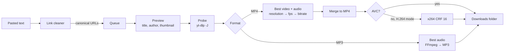

<div align="center">



[](https://github.com/softoblivion/media-saver/releases/latest/download/MediaSaver.exe)
[](https://github.com/softoblivion/media-saver/releases/latest)


[](LICENSE)

**Free open-source YouTube, Instagram, TikTok and X video downloader for Windows. Saves YouTube videos and Shorts, Instagram Reels, TikTok videos and X (Twitter) posts as MP4 (up to 4K) or MP3. Batch links, previews, one portable exe, no installer, no license key, no download limits. The download engine (yt-dlp) and the app update themselves. A free alternative to 4K Video Downloader and similar paid tools.**


<sub>Paste any text with links · pick MP4 or MP3 and the quality · press Download. Engines and the app keep themselves up to date.</sub>

</div>

---

## Why Media Saver

- **Free and open source.** GPL-3.0, no trial, no per-day download cap, no paid tier. The source is here; build it yourself if you prefer.
- **Best quality, no guesswork.** Every format the site offers is compared by resolution, frame rate and bitrate; video and audio are merged into one MP4, or the best audio track becomes an MP3.
- **Links in, files out.** Messages, lists, glued-together URLs, Markdown, `.txt` files: everything is extracted, cleaned to canonical links and de-duplicated before it hits the queue.
- **Keeps working when the sites change.** `yt-dlp`, `gallery-dl`, FFmpeg and the Deno runtime refresh themselves on every launch; the app itself updates from GitHub Releases after a size and SHA-256 check.
- **Portable.** One `MediaSaver.exe`, one data folder next to it. Move the folder, move the app. Your videos go to `Videos\Media-Saver` or any folder you pick.

## Quick start

1. Download [`MediaSaver.exe`](https://github.com/softoblivion/media-saver/releases/latest/download/MediaSaver.exe) and put it into a folder of its own, for example `D:\Apps\MediaSaver\`.
2. Run it. The first start fetches the download engines (about 80 MB; FFmpeg only when none is on `PATH`).
3. Paste links, press **Download**. Files land in `Videos\Media-Saver`; change the folder from the queue header or
   in Settings.

**Requirements:** Windows 10 (1809+) or Windows 11 with the Microsoft Edge WebView2 Runtime (preinstalled on Windows 11
and on up-to-date Windows 10). No installer, no admin rights.

> [!NOTE]
> The executable is not code-signed, so Windows SmartScreen may warn on first start (**More info → Run anyway**).

## Features

| | |
|---|---|
| **Four platforms** | Instagram Reels and video posts; YouTube videos and Shorts; TikTok videos (full and short `vm.tiktok.com` links); X (Twitter) posts with video. A mode switch with one icon per service, centred in the title bar; each mode keeps its own queue view and its own quality setting. |
| **MP4 or MP3** | A global default and a per-item override on queued cards. MP4 picks the highest resolution within the quality step, then frame rate, then bitrate and merges video and audio; MP3 converts the best audio track at the bitrate of the quality step. |
| **Quality per platform** | Four steps for every platform: Low, Medium, High, Max. MP4: ≤ 480p, ≤ 720p, ≤ 1080p, best (YouTube up to 4K, the others up to 1080p). MP3: 128, 192, 256, 320 kbps. Chosen in the main window, right above Download. |
| **Editor-ready video** | Optional H.264 mode: prefers an AVC stream at the top resolution; when only VP9 / AV1 / HEVC exists there (YouTube above 1080p, current Instagram reels, TikTok 1080p), re-encodes with x264 CRF 16 so the file opens in Premiere Pro and After Effects without conversion. |
| **Batch input** | Accepts messages, lists and glued-together links; extracts, cleans and de-duplicates them before queuing. Drag and drop of text and `.txt` files, `Ctrl+V` anywhere in the window. |
| **Previews** | Thumbnail, title, author and duration appear on a queued card before the download starts. |
| **Self-updating engines** | `yt-dlp` (nightly channel by default), `gallery-dl` and FFmpeg are checked on every start and replaced with verified builds when a newer release exists. An extractor-type failure triggers one forced engine update and an automatic retry; rate limits back off and retry. |
| **Self-updating app** | New releases are detected on launch or on request, downloaded into the data folder, verified by size and SHA-256 and installed on restart. |
| **In-app sign-in** | Reels that require an account are handled through Instagram's own login page in a separate window; only the resulting session cookies are stored locally. |
| **Liquid Glass UI** | SVG displacement-map refraction, specular rims, spring physics, morphing controls, four colour themes (Dusk, Nova, Frost, Bloom), a Scale setting from 100 to 200 %, embedded Sora and Geist Mono fonts; animation loops stop when nothing moves. |

## How it works



On every launch a background updater runs before any job starts; links can be queued while it works. The
components it keeps current and their update rules are in the [user guide](docs/USER_GUIDE.md#updates). Without
network access the app keeps working with the binaries it already has.

## Documentation

| Document | What it covers |
|---|---|
| [User guide](docs/USER_GUIDE.md) | Usage, keyboard, settings, link cleaning rules, data folder, updates, FAQ |
| [Architecture](docs/ARCHITECTURE.md) | Stack, layout, modules, runtime data, behaviour, engine facade |
| [Bridge API](docs/BRIDGE_API.md) | The JS ↔ Python contract between the page and the app |
| [Engine](docs/ENGINE.md) | Engine updates, command lines, formats, previews, error codes, site quirks, headless CLI |
| [Self-update](docs/SELF_UPDATE.md) | Release layout, check, verify and apply of the app's own updates |
| [UI design](docs/UI_DESIGN.md) | Design system, Liquid Glass material, typography, motion, copy rules |
| [Build](docs/BUILD.md) | Running from source, tests, building the exe, releasing, troubleshooting |
| [Release notes](docs/releases/) | What changed in every version |
| [Third-party components](docs/THIRD_PARTY.md) | What is bundled or downloaded, with licences |
| [Roadmap](docs/ROADMAP.md) | Planned work |

## Building from source

Requirements: Windows, Python 3.14 (via the `py` launcher), PowerShell 5.1+.

```powershell
git clone https://github.com/softoblivion/media-saver.git
cd media-saver
powershell -ExecutionPolicy Bypass -File build\build.ps1
```

The script creates `.venv`, installs the dependencies, runs the unit tests, generates the icon and produces
`release\MediaSaver.exe` (one-file PyInstaller build, about 12 MB) with `release\SHA256SUMS`. `-Shortcut` also
places a desktop shortcut.

| Task | Command |
|---|---|
| Run from source | `run_dev.bat` (data in `media-saver_data\` under the project root); `run_dev.bat --fake` runs a simulated engine without network |
| Unit tests | `set MEDIA_SAVER_HOME=%TEMP%\ms_tests` then `.venv\Scripts\python.exe -m unittest discover -s tests` |
| Headless download test | `.venv\Scripts\python.exe -m app.core.cli --home <dir> --out <dir> [--platform youtube\|tiktok\|twitter] [--format mp3] <links>` |
| UI in a browser with mock data | `python -m http.server 5173 --directory ui`, then open `http://localhost:5173/?mock=1&demo=1` |

## Disclaimer

Media Saver is an independent project and is not affiliated with, endorsed by or sponsored by Instagram, Meta
Platforms, Inc., YouTube, Google LLC, TikTok, ByteDance Ltd. or X Corp. "Instagram", "Reels", "YouTube",
"Shorts", "TikTok" and "X" are trademarks of their respective owners. Download only content you own or have
permission to use, and follow the Terms of Service of the platforms and the copyright law that applies to you.

## License

Released under the [GNU General Public License v3.0](LICENSE). Any distributed copy or derivative work must stay
open source under the same license and keep the copyright notices.
