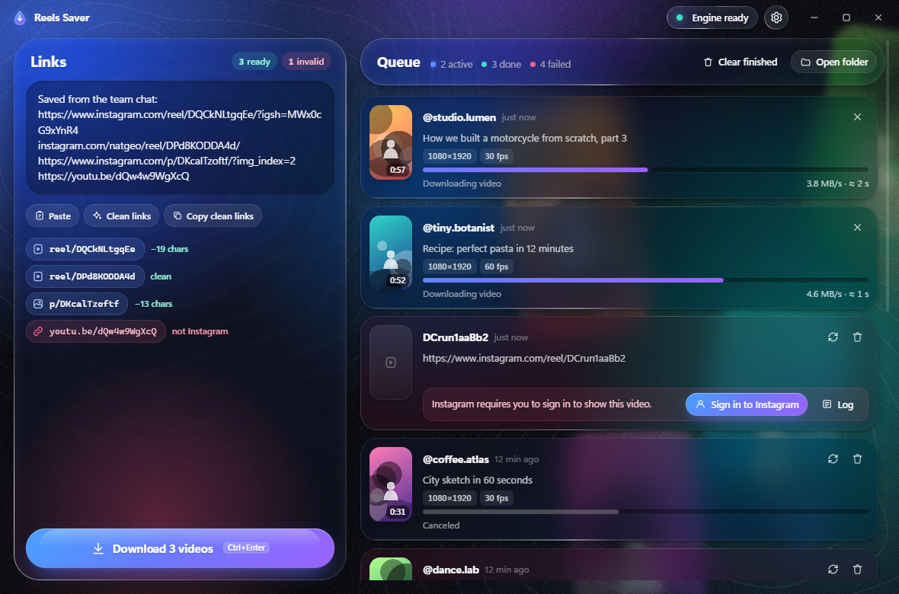
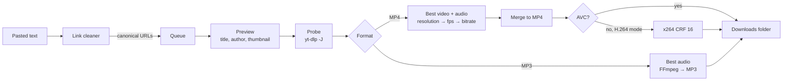

<div align="center">


# Media Saver

**Instagram Reels and YouTube videos or Shorts, saved as MP4 or MP3, from one portable Windows app.**

[](https://github.com/softoblivion/media-saver/releases/latest/download/MediaSaver.exe)
[](https://github.com/softoblivion/media-saver/releases/latest)


[](LICENSE)



<sub>Paste any text with links · pick MP4 or MP3 and the quality · press Download. Engines and the app keep themselves up to date.</sub>

</div>

---

## Contents

- [Why Media Saver](#why-media-saver)
- [Quick start](#quick-start)
- [Features](#features)
- [How it works](#how-it-works)
- [Usage](#usage)
- [Settings](#settings)
- [Link cleaning rules](#link-cleaning-rules)
- [Data and privacy](#data-and-privacy)
- [Updates](#updates)
- [FAQ](#faq)
- [Building from source](#building-from-source)
- [Project structure](#project-structure)
- [Third-party components](#third-party-components)
- [Disclaimer](#disclaimer)
- [License](#license)

## Why Media Saver

- **Best quality, no guesswork.** Every format the site offers is compared by resolution, frame rate and bitrate; video and audio are merged into one MP4, or the best audio track becomes an MP3.
- **Links in, files out.** Messages, lists, glued-together URLs, Markdown, `.txt` files: everything is extracted, cleaned to canonical links and de-duplicated before it hits the queue.
- **Keeps working when the sites change.** `yt-dlp`, `gallery-dl`, FFmpeg and the Deno runtime refresh themselves on every launch; the app itself updates from GitHub Releases after a size and SHA-256 check.
- **Portable.** One `MediaSaver.exe`, one data folder next to it. Move the folder, move the app. Your videos go to `Videos\Media-Saver` or any folder you pick.

## Quick start

1. Download [`MediaSaver.exe`](https://github.com/softoblivion/media-saver/releases/latest/download/MediaSaver.exe) and put it into a folder of its own, for example `D:\Apps\MediaSaver\`.
2. Run it. The first start fetches the download engines (about 80 MB; FFmpeg only when none is on `PATH`).
3. Paste links, press **Download**. Files land in `Videos\Media-Saver`; change the folder from the queue header or
   in Settings.

**Requirements:** Windows 10 (1809+) or Windows 11 with the Microsoft Edge WebView2 Runtime (preinstalled on Windows 11
and on up-to-date Windows 10). No installer, no admin rights.

> [!NOTE]
> The executable is not code-signed, so Windows SmartScreen may warn on first start (**More info → Run anyway**).

## Features

| | |
|---|---|
| **Two platforms** | Instagram Reels and video posts; YouTube videos and Shorts. A mode switch in the title bar; each mode keeps its own queue view and its own quality setting. |
| **MP4 or MP3** | A global default and a per-item override on queued cards. MP4 picks the highest resolution, then frame rate, then bitrate and merges video and audio; MP3 extracts the best audio track at the best available bitrate. |
| **Quality per platform** | Instagram: Low (≤ 480p), Medium (≤ 720p), Max. YouTube: 360p, 720p, Max (up to 4K). Chosen in the main window, right above Download. |
| **Editor-ready video** | Optional H.264 mode: prefers an AVC stream at the top resolution; when only VP9 / AV1 exists there, re-encodes with x264 CRF 16 so the file opens in Premiere Pro and After Effects without conversion. |
| **Batch input** | Accepts messages, lists and glued-together links; extracts, cleans and de-duplicates them before queuing. Drag and drop of text and `.txt` files, `Ctrl+V` anywhere in the window. |
| **Previews** | Thumbnail, title, author and duration appear on a queued card before the download starts. |
| **Self-updating engines** | `yt-dlp` (nightly channel by default), `gallery-dl` and FFmpeg are checked on every start and replaced with verified builds when a newer release exists. |
| **Self-updating app** | New releases are detected on launch or on request, downloaded into the data folder, verified by size and SHA-256 and installed on restart. |
| **Self-healing downloads** | An extractor-type failure triggers one forced engine update and an automatic retry. Rate limits back off and retry. |
| **In-app sign-in** | Reels that require an account are handled through Instagram's own login page in a separate window; only the resulting session cookies are stored locally. |
| **Liquid Glass UI** | SVG displacement-map refraction, specular rims, spring physics, morphing controls, embedded Inter and Geist Mono fonts; animation loops stop when nothing moves. |

## How it works



On every launch a background updater runs before any job starts; links can be queued while it works.

| Component | Source | Update rule |
|---|---|---|
| `yt-dlp.exe` | GitHub releases of yt-dlp (nightly or stable) | Local SHA-256 compared with the release checksum file; `--update-to <channel>` or a verified fresh download |
| `gallery-dl.exe` | Codeberg releases of gallery-dl | Same checksum comparison; built-in `-U` |
| `ffmpeg.exe`, `ffprobe.exe` | System `PATH`, otherwise yt-dlp/FFmpeg-Builds (win64 GPL) | Own copy refreshed at most every 30 days |
| `deno.exe` | System `PATH`, otherwise the official Deno release (win64) | JavaScript runtime for yt-dlp's YouTube extraction; SHA-256 verified; own copy refreshed at most every 30 days |
| `MediaSaver.exe` | GitHub Releases of this repository | Checked on launch; size and SHA-256 verified against `SHA256SUMS`; swapped on restart |

Without network access the app keeps working with the binaries it already has.

## Usage

1. Choose the mode: **Instagram** or **YouTube** (`Alt+1` / `Alt+2`).
2. Paste one or more links into the input panel, or press `Ctrl+V` anywhere in the window. A link of the other
   platform is shown with a **Switch** action.
3. Check the cleaned preview: valid, invalid and duplicate links are counted separately. Pick **MP4** or **MP3**
   and the quality for the current platform.
4. Press **Download** (`Ctrl+Enter`). Each card shows a preview as soon as the site answers, then progress, speed
   and ETA. A queued card can still switch between MP4 and MP3.
5. Finished cards open the file or reveal it in Explorer.

If Instagram refuses a reel without an account, the card offers **Sign in to Instagram**. After sign-in, the
failed jobs retry automatically. YouTube videos that require a signed-in viewer (age-restricted, members-only) can
use the cookies of a browser chosen in Settings.

| Shortcut | Action |
|---|---|
| `Ctrl+V` | Paste into the input panel from anywhere |
| `Ctrl+Enter` | Start downloading the cleaned links |
| `Alt+1` / `Alt+2` | Instagram / YouTube mode |
| `←` `→` | Move a segmented control (mode, format, quality) |
| `Esc` | Close the settings sheet or a popover |

## Settings

| Key | Default | Meaning |
|---|---|---|
| `output_dir` | `%USERPROFILE%\Videos\Media-Saver` | Destination folder (the Windows Videos library, redirected or not) |
| `filename_template` | `{author}_{shortcode}` | Tokens `{author}` `{shortcode}` `{date}` `{title}`; `{shortcode}` (the video id) is required |
| `mode` | `instagram` | `instagram` or `youtube`: the platform shown in the window |
| `format` | `mp4` | Default output format for new jobs, `mp4` or `mp3` |
| `quality_instagram` | `max` | `low` (short side ≤ 480), `medium` (≤ 720) or `max` (MP4 only) |
| `quality_youtube` | `max` | `360`, `720` or `max` (best available, up to 2160p; MP4 only) |
| `h264_compat` | `true` | Guarantee H.264 / AAC output for video editors (MP4 only) |
| `skip_existing` | `true` | Mark a job done when the target file already exists |
| `concurrency` | `2` | Parallel downloads, 1–4, shared by both modes |
| `update_channel` | `nightly` | `nightly` or `stable` channel of yt-dlp |
| `auto_update` | `true` | Check engines on every start |
| `auto_install_updates` | `false` | Download and install a new version without asking (the check itself always runs) |
| `auth_mode` | `auto` | Instagram: `auto` (anonymous first), `always` (session first), `never` |
| `browser_cookies` | *(empty)* | Optional browser to read cookies from: `firefox`, `edge`, `chrome`, `brave`, `opera` (both platforms) |
| `clipboard_watch` | `true` | Offer links found in the clipboard on window focus |
| `open_folder_when_done` | `false` | Open the output folder when the queue drains |

## Link cleaning rules

Every recognised link is reduced to scheme, host, kind and id. Anything after the id is dropped: trailing slashes,
`?igsh=`, `utm_*`, `t=`, `list=`, `si=` and `feature=` parameters, fragments, `/embed` suffixes.

| Input | Result |
|---|---|
| `https://www.instagram.com/reel/DAbC123xYz_/?igsh=MWx0cG9x` | `https://www.instagram.com/reel/DAbC123xYz_` |
| `instagram.com/reels/DAbC123xYz_/` | `https://www.instagram.com/reel/DAbC123xYz_` |
| `https://www.instagram.com/someuser/reel/DAbC123xYz_/` | `https://www.instagram.com/reel/DAbC123xYz_` |
| `https://m.instagram.com/tv/DAbC123xYz_` | `https://www.instagram.com/reel/DAbC123xYz_` |
| `https://www.instagram.com/p/DAbC123xYz_/?img_index=2` | `https://www.instagram.com/p/DAbC123xYz_` |
| `https://l.instagram.com/?u=https%3A%2F%2Fwww.instagram.com%2Freel%2FDAbC123xYz_%2F` | `https://www.instagram.com/reel/DAbC123xYz_` |
| `https://youtu.be/dQw4w9WgXcQ?si=abc&t=42` | `https://www.youtube.com/watch?v=dQw4w9WgXcQ` |
| `https://m.youtube.com/watch?v=dQw4w9WgXcQ&list=PL123&index=2` | `https://www.youtube.com/watch?v=dQw4w9WgXcQ` |
| `https://www.youtube.com/shorts/dQw4w9WgXcQ?feature=share` | `https://www.youtube.com/shorts/dQw4w9WgXcQ` |
| `https://www.youtube.com/embed/dQw4w9WgXcQ` | `https://www.youtube.com/watch?v=dQw4w9WgXcQ` |
| `https://www.instagram.com/stories/someuser/` | rejected: not a single reel or post |
| `https://www.youtube.com/playlist?list=PL123` | rejected: not a single video |

Ids keep their case. Profiles, stories, audio pages, playlists, channels, searches and `/share/` redirect tokens
are reported as unsupported.

## Data and privacy

All runtime data lives in `media-saver_data\` next to `MediaSaver.exe` (override with the `MEDIA_SAVER_HOME`
environment variable); nothing is written to the user profile:

| Path | Content |
|---|---|
| `bin\` | Engine executables and their version records |
| `auth\cookies.txt` | Session cookies from the in-app sign-in (Netscape format) |
| `settings.json`, `history.json` | Preferences and the last 300 finished jobs of both platforms |
| `cache\` | Thumbnails and per-job working files |
| `logs\` | `app.log`, `shell.log` and full engine output of failed jobs |
| `webview\` | WebView2 profile of the sign-in window |
| `updates\` | Downloaded app updates and `apply.log` |

The app never sees or stores the Instagram password: sign-in happens on Instagram's own page. **Sign out** deletes
the cookie file and clears the WebView2 cookies. Network traffic goes only to Instagram, YouTube, GitHub and
Codeberg (engine and app updates).

> [!TIP]
> Upgrading from Reels Saver 1.x: the old app kept its data in `%LOCALAPPDATA%\ReelsSaver`. Copy that folder to
> `<folder of MediaSaver.exe>\media-saver_data` to keep your settings, history and Instagram sign-in; otherwise the
> app starts fresh.

## Updates

- **Engines:** checked on every launch (`auto_update`), or **Update now** in the engine panel.
- **The app:** checked on every launch, or **Check for updates** from the version label next
  to the engine chip. A new release is downloaded to `media-saver_data\updates\`, verified by byte size and SHA-256
  against the `SHA256SUMS` asset of the release, and installed by **Restart to update**: the downloaded exe waits
  for the app to exit, swaps `MediaSaver.exe` (keeping the previous file as `MediaSaver.exe.old` until the new
  one started) and relaunches it. If anything fails the current exe stays untouched. With **Install updates
  automatically** on (Settings, off by default) the download and the restart happen by themselves once the queue
  is idle.
- Versions 2.0.0 and 2.1.0 cannot update themselves (their updater hung in a console window): download the
  current `MediaSaver.exe` once by hand; from 2.1.1 on the update applies in place.
- Every release ships two assets: `MediaSaver.exe` and `SHA256SUMS`. Release notes live in
  [`docs/releases/`](docs/releases/).

## FAQ

**A 4K YouTube video takes minutes and the file is huge.** With *H.264 for editing* on, VP9 / AV1 sources above
1080p are re-encoded at CRF 16 for editors. Pick **720p** for a quick AVC file, or switch H.264 off to keep the
original VP9 / AV1 stream.

**Instagram says it needs a sign-in.** Some reels are served only to accounts. Press **Sign in to Instagram** on the
card; the login happens on Instagram's own page and the failed jobs retry by themselves.

**YouTube asks to confirm you are not a bot.** Choose a browser under *Browser cookies* in Settings; the engine then
uses that browser's YouTube session.

**Where is FFmpeg?** It is used for merging and for MP3. The app takes `ffmpeg.exe` from `PATH` when present and
otherwise downloads a static build into `media-saver_data\bin` on the first launch.

**Can I run two copies?** Yes: each folder is its own installation with its own settings and history.

## Building from source

Requirements: Windows, Python 3.14 (via the `py` launcher), PowerShell 5.1+.

```powershell
git clone https://github.com/softoblivion/media-saver.git
cd media-saver
powershell -ExecutionPolicy Bypass -File build\build.ps1
```

The script creates `.venv`, installs the dependencies, runs the unit tests, generates the icon and produces
`release\MediaSaver.exe` (one-file PyInstaller build, about 12 MB) with `release\SHA256SUMS`. `-Shortcut` also
places a desktop shortcut.

| Task | Command |
|---|---|
| Run from source | `run_dev.bat` (data in `media-saver_data\` under the project root) |
| Run with a simulated engine (no network) | `run_dev.bat --fake` |
| Unit tests | `set MEDIA_SAVER_HOME=%TEMP%\ms_tests` then `.venv\Scripts\python.exe -m unittest discover -s tests` |
| Headless download test | `.venv\Scripts\python.exe -m app.core.cli --home <dir> --out <dir> [--platform youtube] [--format mp3] <links>` |
| UI in a browser with mock data | `python -m http.server 5173 --directory ui`, then open `http://localhost:5173/?mock=1&demo=1` |

Architecture, the JS ↔ Python contract, engine details, self-update and build notes:
[ARCHITECTURE](docs/ARCHITECTURE.md) · [BRIDGE_API](docs/BRIDGE_API.md) · [ENGINE](docs/ENGINE.md) ·
[SELF_UPDATE](docs/SELF_UPDATE.md) · [UI_DESIGN](docs/UI_DESIGN.md) · [BUILD](docs/BUILD.md)

## Project structure

```
media-saver/
├── app/
│   ├── core/            download engine (stdlib only): updater, self-update, queue, link cleaner, auth, settings, CLI
│   ├── main.py          entry point: windows, single instance, engine lifecycle
│   ├── bridge.py        JS ↔ Python API and event pump
│   ├── login.py         Instagram sign-in window and cookie capture
│   ├── winutil.py       clipboard, Explorer, DWM, frameless resize
│   └── fake_engine.py   simulated engine for UI work
├── ui/                  HTML / CSS / JS interface, Liquid Glass material, embedded fonts, mock API
├── tests/               unittest suite
├── build/               PyInstaller spec, build script, icon generator
└── docs/                architecture, API contract, engine, self-update, UI and build notes, release notes
```

## Third-party components

Bundled into the executable:

| Component | License |
|---|---|
| [CPython](https://www.python.org/) | PSF-2.0 |
| [pywebview](https://github.com/r0x0r/pywebview) | BSD-3-Clause |
| [pythonnet](https://github.com/pythonnet/pythonnet), clr_loader | MIT |
| bottle, proxy_tools | MIT |
| cffi / pycparser | MIT-0 / BSD-3-Clause |
| [PyInstaller](https://pyinstaller.org/) bootloader | GPL-2.0-or-later with the bootloader exception |
| [Inter](https://github.com/rsms/inter), [Geist Mono](https://github.com/vercel/geist-font) fonts | SIL Open Font License 1.1 |

Downloaded at runtime from their official release channels, not redistributed with this project:

| Component | License |
|---|---|
| [yt-dlp](https://github.com/yt-dlp/yt-dlp) | Unlicense |
| [gallery-dl](https://codeberg.org/mikf/gallery-dl) | GPL-2.0 |
| [FFmpeg](https://ffmpeg.org/) ([yt-dlp/FFmpeg-Builds](https://github.com/yt-dlp/FFmpeg-Builds)) | GPL |
| [Deno](https://github.com/denoland/deno) | MIT |

## Disclaimer

Media Saver is an independent project and is not affiliated with, endorsed by or sponsored by Instagram, Meta
Platforms, Inc., YouTube or Google LLC. "Instagram", "Reels", "YouTube" and "Shorts" are trademarks of their
respective owners. Download only content you own or have permission to use, and follow the Terms of Service of the
platforms and the copyright law that applies to you.

## License

Released under the [GNU General Public License v3.0](LICENSE). Any distributed copy or derivative work must stay
open source under the same license and keep the copyright notices.
