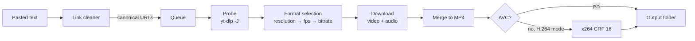

<div align="center">

# Reels Saver


[](https://github.com/notyaffi/reels-saver/releases/latest)
[](LICENSE)

A Windows desktop app that saves Instagram Reels at the best quality Instagram currently serves.
Paste any amount of text with links, get clean canonical URLs and a download queue. The download engines
refresh themselves on every launch, so extractor fixes arrive without a new build of the app.
Single portable `.exe`, Liquid Glass interface rendered with WebView2.


</div>

---

## Contents

- [Features](#features)
- [How it works](#how-it-works)
- [Installation](#installation)
- [Usage](#usage)
- [Settings](#settings)
- [Link cleaning rules](#link-cleaning-rules)
- [Data and privacy](#data-and-privacy)
- [Building from source](#building-from-source)
- [Project structure](#project-structure)
- [Third-party components](#third-party-components)
- [Disclaimer](#disclaimer)
- [License](#license)

## Features

| | |
|---|---|
| **Maximum quality** | Picks the highest resolution, then frame rate, then bitrate from every format Instagram offers (DASH and progressive) and merges video and audio into MP4. |
| **Editor-ready output** | Optional H.264 mode: prefers an AVC stream at the top resolution; when only VP9 / AV1 exists there, re-encodes with x264 CRF 16 so the file opens in Premiere Pro and After Effects without conversion. |
| **Batch input** | Accepts messages, lists and glued-together links; extracts, cleans and de-duplicates them before queuing. Drag and drop of text and `.txt` files, `Ctrl+V` anywhere in the window. |
| **Self-updating engines** | `yt-dlp` (nightly channel by default), `gallery-dl` and FFmpeg are checked on every start and replaced with verified builds when a newer release exists. |
| **Self-healing downloads** | An extractor-type failure triggers one forced engine update and an automatic retry. Rate limits back off and retry. |
| **In-app sign-in** | Reels that require an account are handled through Instagram's own login page in a separate window; only the resulting session cookies are stored locally. |
| **Fallback chain** | Anonymous request → saved session → optional browser cookies → `gallery-dl`. |
| **Clipboard prompt** | When the window gains focus, links found in the clipboard are offered for download. |
| **Liquid Glass UI** | SVG displacement-map refraction, specular rims, spring physics, morphing controls; animation loops stop when nothing moves. |

## How it works



On every launch a background updater runs before any job starts; links can be queued while it works.

| Component | Source | Update rule |
|---|---|---|
| `yt-dlp.exe` | GitHub releases of yt-dlp (nightly or stable) | Local SHA-256 compared with the release checksum file; `--update-to <channel>` or a verified fresh download |
| `gallery-dl.exe` | Codeberg releases of gallery-dl | Same checksum comparison; built-in `-U` |
| `ffmpeg.exe`, `ffprobe.exe` | System `PATH`, otherwise yt-dlp/FFmpeg-Builds (win64 GPL) | Own copy refreshed at most every 30 days |

Without network access the app keeps working with the binaries it already has.

## Installation

1. Download `ReelsSaver.exe` from the [latest release](https://github.com/notyaffi/reels-saver/releases/latest).
2. Run it. No installer and no admin rights are needed.

> [!NOTE]
> The executable is not code-signed, so Windows SmartScreen may show a warning on first start
> (**More info → Run anyway**).

> [!IMPORTANT]
> The first start downloads `yt-dlp` and `gallery-dl` (about 40 MB). FFmpeg (about 200 MB archive) is fetched only
> when no `ffmpeg.exe` is found on `PATH`.

**Requirements:** Windows 10 (1809+) or Windows 11 with the Microsoft Edge WebView2 Runtime (preinstalled on
Windows 11 and on up-to-date Windows 10). Developed and tested on Windows 11.

## Usage

1. Paste one or more links into the input panel, or press `Ctrl+V` anywhere in the window.
2. Check the cleaned preview: valid, invalid and duplicate links are counted separately.
3. Press **Download** (`Ctrl+Enter`). Progress, speed and ETA appear per card in the queue.
4. Finished cards open the file or reveal it in Explorer.

If Instagram refuses a reel without an account, the card offers **Sign in to Instagram**. After sign-in, the
failed jobs retry automatically.

| Shortcut | Action |
|---|---|
| `Ctrl+V` | Paste into the input panel from anywhere |
| `Ctrl+Enter` | Start downloading the cleaned links |
| `Esc` | Close the settings sheet or a popover |

## Settings

| Key | Default | Meaning |
|---|---|---|
| `output_dir` | `%USERPROFILE%\Downloads\Reels Saver` | Destination folder |
| `filename_template` | `{author}_{shortcode}` | Tokens `{author}` `{shortcode}` `{date}` `{title}`; `{shortcode}` is required |
| `quality` | `max` | `max`, `1080` or `720` (caps the short side) |
| `h264_compat` | `true` | Guarantee H.264 / AAC output for video editors |
| `skip_existing` | `true` | Mark a job done when the target file already exists |
| `concurrency` | `2` | Parallel downloads, 1–4 |
| `update_channel` | `nightly` | `nightly` or `stable` channel of yt-dlp |
| `auto_update` | `true` | Check engines on every start |
| `auth_mode` | `auto` | `auto` (anonymous first), `always` (session first), `never` |
| `browser_cookies` | *(empty)* | Optional browser to read cookies from: `firefox`, `edge`, `chrome`, `brave`, `opera` |
| `clipboard_watch` | `true` | Offer links found in the clipboard on window focus |
| `open_folder_when_done` | `false` | Open the output folder when the queue drains |

## Link cleaning rules

Every recognised link is reduced to scheme, host, kind and shortcode. Anything after the shortcode is dropped:
trailing slashes, `?igsh=` and `utm_*` parameters, fragments, `/embed` suffixes.

| Input | Result |
|---|---|
| `https://www.instagram.com/reel/DAbC123xYz_/?igsh=MWx0cG9x` | `https://www.instagram.com/reel/DAbC123xYz_` |
| `instagram.com/reels/DAbC123xYz_/` | `https://www.instagram.com/reel/DAbC123xYz_` |
| `https://www.instagram.com/someuser/reel/DAbC123xYz_/` | `https://www.instagram.com/reel/DAbC123xYz_` |
| `https://m.instagram.com/tv/DAbC123xYz_` | `https://www.instagram.com/reel/DAbC123xYz_` |
| `https://www.instagram.com/p/DAbC123xYz_/?img_index=2` | `https://www.instagram.com/p/DAbC123xYz_` |
| `https://l.instagram.com/?u=https%3A%2F%2Fwww.instagram.com%2Freel%2FDAbC123xYz_%2F` | `https://www.instagram.com/reel/DAbC123xYz_` |
| `https://www.instagram.com/stories/someuser/` | rejected: not a single reel or post |

Shortcodes keep their case. Profiles, stories, audio pages and `/share/` redirect tokens are reported as unsupported.

## Data and privacy

All runtime data lives under `%LOCALAPPDATA%\ReelsSaver` (override with the `REELS_SAVER_HOME` environment variable):

| Path | Content |
|---|---|
| `bin\` | Engine executables and their version records |
| `auth\cookies.txt` | Session cookies from the in-app sign-in (Netscape format) |
| `settings.json`, `history.json` | Preferences and the last 300 finished jobs |
| `cache\` | Thumbnails and per-job working files |
| `logs\` | `app.log`, `shell.log` and full engine output of failed jobs |
| `webview\` | WebView2 profile of the sign-in window |

The app never sees or stores the Instagram password: sign-in happens on Instagram's own page. **Sign out** deletes
the cookie file and clears the WebView2 cookies. Network traffic goes only to Instagram, GitHub and Codeberg
(engine updates).

## Building from source

Requirements: Windows, Python 3.14 (via the `py` launcher), PowerShell 5.1+.

```powershell
git clone https://github.com/notyaffi/reels-saver.git
cd reels-saver
powershell -ExecutionPolicy Bypass -File build\build.ps1
```

The script creates `.venv`, installs the dependencies, runs the unit tests, generates the icon and produces
`release\ReelsSaver.exe` (one-file PyInstaller build, about 12 MB). `-Shortcut` also places a desktop shortcut.

| Task | Command |
|---|---|
| Run from source | `run_dev.bat` |
| Run with a simulated engine (no network) | `run_dev.bat --fake` |
| Unit tests | `.venv\Scripts\python.exe -m unittest discover -s tests` |
| Headless download test | `.venv\Scripts\python.exe -m app.core.cli --home <dir> --out <dir> <links>` |
| UI in a browser with mock data | `python -m http.server 5173 --directory ui`, then open `http://localhost:5173/?mock=1&demo=1` |

Architecture, the JS ↔ Python contract, engine details and build notes:
[ARCHITECTURE](docs/ARCHITECTURE.md) · [BRIDGE_API](docs/BRIDGE_API.md) · [ENGINE](docs/ENGINE.md) ·
[UI_DESIGN](docs/UI_DESIGN.md) · [BUILD](docs/BUILD.md)

## Project structure

```
reels-saver/
├── app/
│   ├── core/            download engine (stdlib only): updater, queue, link cleaner, auth, settings, CLI
│   ├── main.py          entry point: windows, single instance, engine lifecycle
│   ├── bridge.py        JS ↔ Python API and event pump
│   ├── login.py         Instagram sign-in window and cookie capture
│   ├── winutil.py       clipboard, Explorer, DWM, frameless resize
│   └── fake_engine.py   simulated engine for UI work
├── ui/                  HTML / CSS / JS interface, Liquid Glass material, mock API
├── tests/               unittest suite
├── build/               PyInstaller spec, build script, icon generator
└── docs/                architecture, API contract, engine, UI and build notes, release notes
```

## Third-party components

Bundled into the executable:

| Component | License |
|---|---|
| [CPython](https://www.python.org/) | PSF-2.0 |
| [pywebview](https://github.com/r0x0r/pywebview) | BSD-3-Clause |
| [pythonnet](https://github.com/pythonnet/pythonnet), clr_loader | MIT |
| bottle, proxy_tools | MIT |
| cffi / pycparser | MIT-0 / BSD-3-Clause |
| [PyInstaller](https://pyinstaller.org/) bootloader | GPL-2.0-or-later with the bootloader exception |

Downloaded at runtime from their official release channels, not redistributed with this project:

| Component | License |
|---|---|
| [yt-dlp](https://github.com/yt-dlp/yt-dlp) | Unlicense |
| [gallery-dl](https://codeberg.org/mikf/gallery-dl) | GPL-2.0 |
| [FFmpeg](https://ffmpeg.org/) ([yt-dlp/FFmpeg-Builds](https://github.com/yt-dlp/FFmpeg-Builds)) | GPL |

## Disclaimer

Reels Saver is an independent project and is not affiliated with, endorsed by or sponsored by Instagram or Meta
Platforms, Inc. "Instagram" and "Reels" are trademarks of their respective owner. Download only content you own or
have permission to use, and follow Instagram's Terms of Use and the copyright law that applies to you.

## License

Released under the [GNU General Public License v3.0](LICENSE). Any distributed copy or derivative work must stay
open source under the same license and keep the copyright notices.
